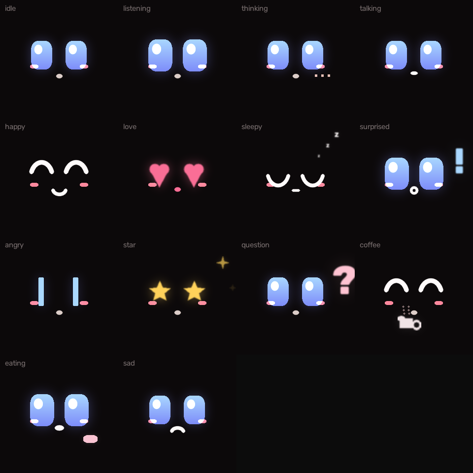
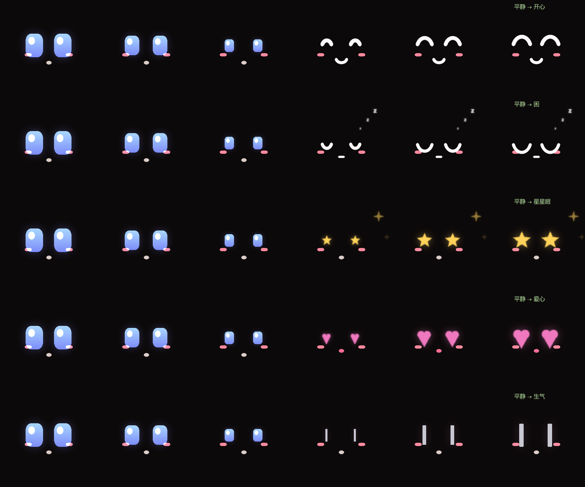

# 汤圆



<sub>14 种表情，全部由代码画出来（超椭圆 + 渐变 + 外发光），不是图片素材。</sub>



<sub>表情之间是连续变形，不是硬切。形状要变的地方会「眯一下眼」遮住。</sub>

> 一只住在你电脑里、以后要装到机器人身上的小东西。
> 它叫汤圆。看得见你、听得出你的语气，然后**真的去做**。

**状态**：v0.1，2026-11。跑在 Mac 上，用麦克风/喇叭/摄像头之前先跑通"想"和"做"。

---

## 这个项目是怎么来的

代码是和 AI 一起写的。说清楚边界，省得你猜：

**我定的**（这些是判断，不是执行）

- 做什么：桌面陪伴机器人。**不走路，不做通用具身智能**
- 砍掉什么：四足步态（训练不收敛就交不出东西）、声纹识别（实测分不开人）
- 每个功能的取舍：情绪必须**会退**，否则会变成一台抑郁的机器

**AI 写的**

- 大部分实现代码、测试、文档初稿

**我验的**

- 每个功能都自己跑过；跑不通就改，改不动就砍

## 翻过的车

留下的都是真的，不是为了好看：

| 踩的坑 | 后来怎么办的 |
|---|---|
| macOS 新音色说中文输出 **0.016 秒静音**，返回码还是 0 | 选音色前先量一遍时长，只看"成功"会上当 |
| 在线音色被 TLS 拦，随时退回机械音 | 挂一次就静默降级，不每句刷屏 |
| 声纹模型跨说话人只差 **0.09**，判不准 | 放弃声纹，改用"叫名字才动手" |
| 两个表情窗口抢端口，看着像"没弹出来" | 端口被占就直接退出，不再开第二个 |
| 每听一句都重开麦克风，**开头 300ms 被吃掉** | 流只开一次 + 预录 1 秒 |
| 历史按"条数"裁，一次看屏幕的两千字把刚说的话挤掉 | 改成按字符预算，裁掉的压成摘要 |


## 1. 它和聊天机器人差在哪

聊天机器人只会说。这个会**动手**：

| 你说 | 它做什么 |
|---|---|
| 现在几点 | 调 `get_time`，读系统时间 |
| 打开计算器 | 调 `open_app`，真的打开 |
| 帮我截个图 | 调 `screenshot`，存一张 PNG |
| 还剩多少电 | 调 `system_status`，读电量磁盘 |
| 记住我明天要买网线 | 调 `remember`，写进 `data/notes.json` |
| 我之前说过什么 | 调 `recall`，翻出来 |
| 你看得见我吗 | 调 `look_around`，开摄像头看 | 
| 声音小一点 | 调 `set_volume`，真的调系统音量 |
| 提醒我十分钟后喝水 | 调 `notify`，弹系统通知 |
| 我桌面上有什么 | 调 `list_files`，列桌面 |

回答会念出来（macOS 自带的中文音色）。

## 2. 跑起来

1. 打开 `config.json`，把 `api_key` 填上你自己的 key（DeepSeek / 通义 / 智谱 / Kimi 都行，
   换供应商只改 `base_url` 和 `model` 两个字符串）
2. 双击 **「启动大脑.command」**
3. 先看它报不报"通了"

命令行也行：

```bash
python3 main.py --check           # 只测 key 通不通
python3 main.py                   # 打字对话（回答会念出来）
python3 main.py --talk            # 语音对话：直接说话，不用按键
python3 main.py --transcribe x.wav # 只测耳朵
python3 main.py --once "现在几点"   # 问一句就退
```

两个权限，第一次会各弹一次：

- **麦克风**（`--talk` 时）→「系统设置 → 隐私与安全性 → 麦克风」允许终端
- **屏幕录制**（`screenshot` 时）→「系统设置 → 隐私与安全性 → 屏幕录制」允许终端

## 2.5 耳朵

`--talk` 的识别引擎在 `config.json` 里选，两个都离线：

| `asr` | 模型 | 大小 | 中文 | 加载 |
|---|---|---|---|---|
| `whisper`（默认） | faster-whisper small | 460MB | 更好 | 1.0s |
| `vosk` | vosk small-cn | 44MB | 一般 | 0.5s |

模型都在 `models/` 下，**不要提交到仓库**。第一次用 whisper 会自动下（国内走
hf-mirror，约 20 分钟）；已经下过就直接从本地路径加载。

两个坑，都是实测踩出来的：

- 传 `"small"` 给 faster-whisper 会**先去 HuggingFace 检查更新**，国内卡 76 秒。
  改成传本地目录路径后，加载 **1.0 秒**。
- 模型文件用 xet 加速下载会报 `I/O error`，要 `HF_HUB_DISABLE_XET=1`。

"什么时候开始听"不写死，先测 0.5 秒环境噪声，再按 2.5 倍定阈值 —— 换房间、
换空调不用改代码。连续 3 帧（150ms）超过阈值才算开口，说完安静 0.7 秒算结束。

一句话的往返大概 1.5 秒（识别 + 模型 + 朗读），够日常用，做不到丝滑。

## 2.6 眼睛

`look_around` 会开摄像头抓 8 帧（半秒），取人脸最多的那一帧来判断：几个人、
有没有人在看你、离得近不近。

用的是 YuNet（227KB，和「盯盯」同一个模型）。头部朝向用**同帧瞳距归一化**，
所以站着还是坐着、离得远还是近，读数一样。

## 2.6.5 声音有两套

| | 音色 | 要联网 | 说明 |
|---|---|---|---|
| 在线 | Edge（8 个中文） | 是 | 晓晓 / 云希 / 云扬…，真人级 |
| 本机 | macOS `say`（3 个能出声） | 否 | Meijia / Tingting / Sinji，机械 |

先试在线，失败**自动退回本机** —— 断网了它不会哑。多花 0.5—1 秒。

一个坑：macOS 新加的一堆音色（Flo / Eddy / Grandpa…）说中文时输出 0.016 秒
静音，而且**返回码是 0**。所以选音色之前必须量一遍时长，只看"成功"会上当。

## 2.7 心情

它**不听你说什么，听你怎么说**。一句语音留两样东西：音量（dBFS）和音高（f0，
自相关估算）。然后和**你平时的样子**比 —— 前几句建立基准，后面看倍数。

- 比平时大声、调门高 → `有精神`，它回得快一点
- 比平时小声、调门低 → `低落`，它把语速放慢到 150
- 样本不够 3 句 → 老实说"还听不出"，不瞎猜

绝对音量因人而异（有人天生嗓门大），所以只比相对变化。**一个总在乱猜心情的
机器人，比不猜的更烦人。**

## 3. 它怎么想事情

```
你说一句话
    │
    ▼
┌──────────────────────────────────────┐
│ 大脑（模型）                          │
│   ├─ 能直接回答 → 回答                │
│   └─ 需要动手 → 点名一个工具、给参数    │
└──────────────┬───────────────────────┘
               ▼
        工具真的执行（打开应用 / 截图 / 读时间…）
               │
               ▼
        结果原样塞回大脑 → 大脑看着结果继续想
               │
               ▼
             回答 ──▶ 嘴（say）念出来
```

最多绕 5 步（`max_steps`）。绕不出来就体面地停下，不会无限循环烧钱。

```
agent/
  brain.py    跟模型说话（只用标准库 urllib，不装 SDK）
  tools.py    它能做的手：每个能力 = 一个函数 + 一段说明书
  loop.py     想的循环：调工具、看结果、再来一轮
  voice.py    嘴：今天用 macOS 的 say，以后换喇叭只改这一个文件
  config.py   配置：json 文件或环境变量
```

## 3.5 情绪：会变、会退、能说清

`data/feelings.json` 里存四个数：愉悦度、精力、熟悉度、上次说话的时间。
（`agent/feelings.py`）

**三条硬规矩，不然就是假情绪：**

1. **慢**。一次夸奖 +0.12，一次冷落 −0.10。刷十次才会变一个人。
2. **会退**。什么都不发生，它自己漂回基线。没有这条，情绪会一直往下掉，
   最后变成一台抑郁的机器 —— 那不是陪伴，是负担。
3. **能说清为什么**。每笔变动都记着事件和时间，所以被问「你怎么了」的时候，
   它答得出「你今天三次没理我」。

**它怎么影响说话：**

| 状态 | 语速 | 音高 |
|---|---|---|
| 精力低 | 140—160 | 不变 |
| 开心 | 更快 | +12Hz |
| 被冷落 | 变慢 | 略低 |

**情绪会传染**：你说话声音低落，她的精力也跟着掉一点（`user_low`）。

## 3.6 主动开口

安静超过 90 秒、且距上次主动超过 10 分钟，她会自己说一句。
深夜或很久没见，主题会变（"你怎么还不睡" / "你回来了"）。

⚠️ 演示时它会打断你。想静音就删掉 `data/feelings.json` 重新开始 ——
或者跟她说一句"你先别说话"，情绪还在，只是安静。

## 3.55 表情窗口

`face.py` 是她的脸：圆角方眼、渐变、外发光、14 种表情、随机眨眼（含连眨）。
**启动大脑时自动拉起**，退出时自动关掉（`face_up()` / `face_down()`）。

对话过程中的四个节点：

| 时刻 | 表情 |
|---|---|
| 你在说话 | `listening` 睁大眼睛 |
| 她在想 | `thinking` 三个点跳 |
| 她开口 | `talking` 嘴一张一合 |
| 说完 | 按心情 `happy` / `sleepy` / `angry` / `love` … |

单独看：`python3 face.py`，空格翻页、`a` 轮播、`q` 退出。
不想开：`--no-face`。

## 3.6 看屏幕（可选）

`look_at_screen` 会截图、缩到 1600px、转 base64，交给一个**能看图的模型**回答。

为什么要另配一个：对话用的 DeepSeek 是纯文本模型。视觉端点单独写在
`config.json` 里（`vision_*` 三项），走 OpenAI 兼容格式，换供应商只改三个字符串。

推荐 **智谱 GLM-4V-Flash**（有免费额度，学生够用）。没配也不会坏 ——
工具会老实说"还没接上视觉模型"，其余功能照常。

**它能做到**：看懂屏幕、回答"这个按钮是干嘛的"、把屏幕上的字抄进备忘录、
告诉你第一步点哪。
**它做不到**：替你点鼠标。那要走辅助功能自动化，脆弱且危险，不建议。

## 3.65 备忘录与闹钟

| 你说 | 她做什么 |
|---|---|
| 帮我记一下：周五交表 | 写进「备忘录」App（没授权就存成 md 文件） |
| 十分钟后提醒我喝水 | `set_timer` → 到点直接念出来 |
| 明早七点半叫我 | `set_alarm` |
| 我设了哪些闹钟 | `list_alarms` |

闹钟的精度受限于主循环：她在等你说话时是阻塞的，所以最多晚一个 listen 周期
（约 10 秒）。对"十分钟后喝水"够用，对"准点开会"不够 —— 那就该用系统日历。

进程关掉再打开也会检查一次：关机期间错过的，会说「呃，七点半的闹钟我刚才没赶上」。

## 3.7 七个小功能

都不大，但每一个都只加二三十行 —— 因为它们都长在已有的三套系统上
（记忆 / 情绪 / 约定），没有各自另起炉灶。

| 功能 | 怎么实现的 | 代码 |
|---|---|---|
| 记住你答应过的事 | `data/promises.json`，到期那天在开场白里问 | `promises.py` |
| 被冷落会闹别扭 | 隔 18 小时以上 + 心情本来就低 → 开场白变冷 | `feelings.sulk` |
| 有作息 | 精力基线按小时走：凌晨 0.22，白天 0.62 | `_circadian_energy` |
| 知道你的痛处但不提 | 敏感记忆单独存，提示词里写"绝不主动提" | `memory.private` |
| 吐槽你的桌面 | 已有的 `list_files` + 提示词允许偶尔开一句玩笑 | `tools.py` |
| 认识第 N 天 | `first_met` + `days_known` | `feelings.py` |
| 有自己的小爱好 | 每三次主动开口里有一次是"说点跟工作无关的" | `proactive_context` |

**为什么不做成七套系统**：每多一套状态就要多存一个文件、多写一份测试、
多一个坏掉的地方。八个功能应该共享三套状态，而不是八个状态。

## 4. 三个真正难的地方

**① 工具会失败，而且不能崩。** 应用名写错、没授权、网络断 —— 这些错误会被
原样喂回给模型，让它自己换条路。人不会因为一次失败就放弃，它也不该。

**② 模型会绕圈。** "查时间→不确定→再查→再不确定"是真实会发生的。所以有
`max_steps`，而且测试里专门有一条：连续给 10 轮工具调用，必须第 3 轮停下。

**③ 安全边界。** 模型自己决定调什么、传什么参数，所以：
- `run_shell` 只认白名单（`ls/date/df/du/pwd/whoami/uname/sw_vers/sysctl/ps`），
  带管道、重定向、反引号的一律拒绝
- 其他工具不拼字符串进 shell，参数直接进 argv
- 删除文件、发消息、花钱这类事，系统提示里要求它先问一句

一条原则：**一个助手如果能把任意命令跑起来，它就不是助手，是后门。**

## 5. 搬到一个真的机器人上，要改什么

| 能力 | 现在 | 装上材料之后 |
|---|---|---|
| 听 | 打字 | 麦克风 + 语音识别（Whisper / 板载 ASR） |
| 说 | `say` 命令 | 喇叭（`aplay` / ALSA），只改 `voice.py` |
| 看 | 没有 | 接上「盯盯」那套：谁在、几个、在不在看我 |
| 动 | 没有 | 舵机 / 底盘，加一个 `move` 工具 |
| 大脑 | 云端 API | 板子上跑小模型，或者继续走云端 |

核心（`loop.py` + `tools.py`）一行都不用改 —— 这是当初把它拆成五个文件的原因。

## 6. 和「盯盯」的关系

- **盯盯** = 眼睛：看得见谁在、在不在看你
- **大脑** = 想和做：听懂、决定、动手

两个合起来才是一个完整的东西。下一步就是把盯盯包成一个工具：
`look_around()` → "现在有 2 个人，左边那位在看你"。

## 7. 测试

```bash
python3 tests/run_all.py
```

13 个用例，不联网、不花钱，用假的"大脑"：
直接回答、调一次工具、工具名写错、参数不是 JSON、模型绕圈、网络中断、
历史截断；还有心情模块的音高、音量、基准比较。跑的是最危险的那几条路。

## 8. 已知限制

- 只有文字输入。想说话得加麦克风（下一步）。
- 模型偶尔会"假装"做过某事 —— 系统提示里压着，但不能百分百保证。所以
  回答里凡是涉及"我做了X"，都要求它说清是哪个工具做的。
- 没有长期记忆库里说的"理解"，只有 `remember/recall` 这种记事本。

## 素材来源与许可

这个项目里有一部分是别人的东西，按原许可使用：

| 来源 | 用途 | 许可 |
|---|---|---|
| [love-as-a-skill](https://github.com/HetMeesterwerk/love-as-a-skill) | `skills/love/`（提炼后的守则 + 原文留档） | MIT |
| [agent-memory-skill](https://github.com/smixs/agent-memory-skill) | 遗忘曲线的思路；`skills/memory/` 保留了原引擎 | MIT |
| [worldview-profiler](https://github.com/guxiao7538/worldview-profiler) | `skills/worldview/`（含问题库、谱系地图） | MIT |
| [wespeaker](https://github.com/wenet-e2e/wespeaker) | 声纹模型（实验性，未启用） | Apache-2.0 |
| [YuNet / OpenCV Zoo](https://github.com/opencv/opencv_zoo) | 人脸检测 | MIT |
| [Vosk](https://alphacephei.com/vosk/) | 备用离线识别 | Apache-2.0 |
| [faster-whisper](https://github.com/SYSTRAN/faster-whisper) | 主识别 | MIT |
| [edge-tts](https://github.com/rany2/edge-tts) | 在线音色 | GPL-3.0 |

三个 skill 的 LICENSE 原文在各自目录里。

**不包含在本仓库里的东西**（`.gitignore` 已排除）：模型文件（564MB）、
`config.json`（含 API key）、`data/`（你的记忆和情绪）。
